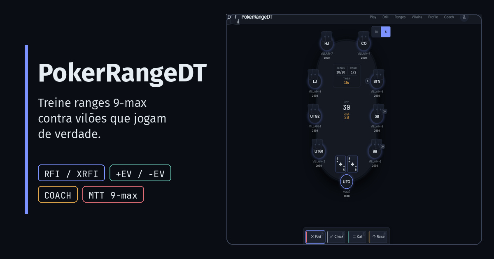
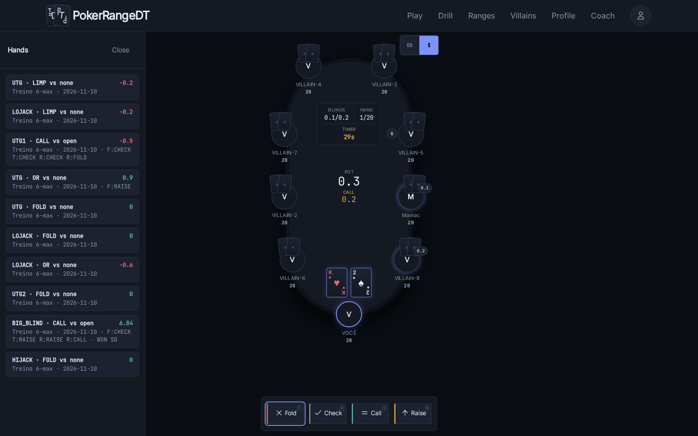
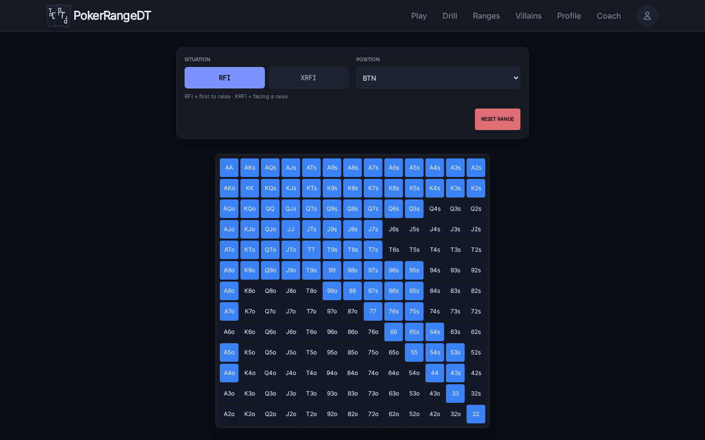
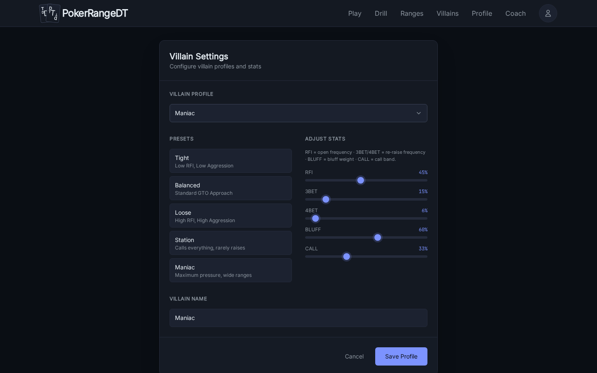
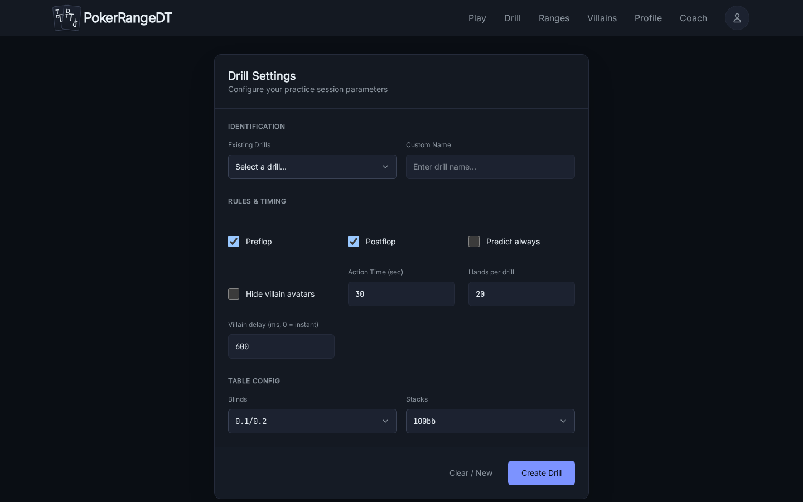
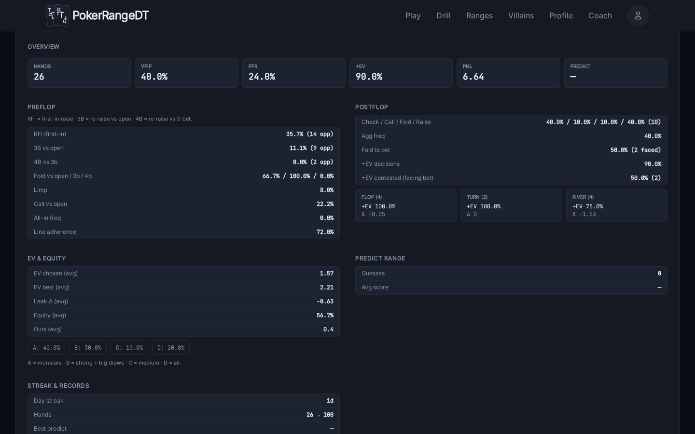
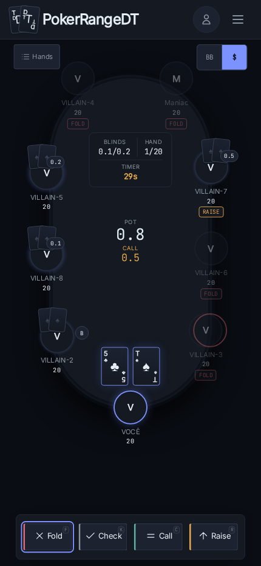

<div align="center">

# ♠ PokerRangeDT

**Treine ranges 9-max contra vilões que jogam de verdade.**




</div>

Drills repetitivos de pré-flop e pós-flop numa mesa 9-max viva. Você pinta seus ranges, configura os vilões e joga mão atrás de mão, com nota imediata em cada decisão e um coach que aponta onde o seu dinheiro vaza.

## Destaques

- **Mesa 9-max completa**: blinds, stacks, side pots, showdown, relógio por decisão e atalhos de teclado.
- **Ranges como fonte da verdade**: matriz 13×13 com RFI e XRFI por posição. O que você pinta é o que os vilões e a sua nota obedecem.
- **Vilões com personalidade**: cinco presets (Tight, Balanced, Loose, Station, Maniac) com frequência de open, 3-bet, 4-bet, blefe e call ajustáveis.
- **Drills sob medida**: só pré-flop, só pós-flop ou full; tempo, número de mãos, blinds e stacks configuráveis; modo Predict para adivinhar o range do vilão.
- **Feedback em cada decisão**: `+EV ✓` ou `−EV ✗` na hora, pré-flop contra a sua linha pintada e pós-flop por cálculo de EV.
- **Coach e Profile**: VPIP, PFR, 3-bet, WTSD, PnL e histórico mão a mão em formato PokerStars, pronto para colar no solver.
- **Mobile-first**: a mesa é desenhada para 430×932 e escala proporcionalmente para qualquer tela.

## Em ação

### A mesa


Nove lugares, pote ao vivo, relógio e botões com atalho (`F` fold, `K` check, `C` call, `R` raise). Pagar caro fora da linha dói; largar certo passa em silêncio.

### Pinte seu jogo


RFI (first-in) e XRFI (contra raise) por posição, com linhas como `OR`, `3B`, `CALL`, `4B` e tetos de call.

### Vilões


Tight folda, Station paga tudo, Maniac pressiona. Cada perfil pode ser ajustado campo a campo.

### Drills


Monte a sessão com o formato, o ritmo e a profundidade de stack que você quer treinar.

### Números, não achismo


O Profile registra o que você **jogou**, não o que pintou. Amostra mínima honesta, sem mock.

### No bolso
<p align="center"></p>

## O ciclo

1. **Pinte** os ranges por posição em `Ranges`.
2. **Configure** vilões e drill em `Villains` e `Drill`.
3. **Jogue** mãos com relógio em `Play`.
4. **Entenda** o vazamento em `Coach`, com as mãos onde ele aconteceu.
5. **Acompanhe** a evolução em `Profile`.

## Começando

Requer Node.js 20.19+ (ou 22.12+).

```bash
git clone https://github.com/IagoMonte/PokerRangeDT.git
cd PokerRangeDT
npm install
npm run dev
```

O app sobe em `http://localhost:11434`.

| Comando | O que faz |
| --- | --- |
| `npm run dev` | servidor de desenvolvimento |
| `npm run build` | build de produção em `dist/` |
| `npm run preview` | serve o build localmente |
| `npm test` | suíte completa (Vitest) |

## Estrutura

```
src/
├── engine/        regras puras: mesa, pré/pós-flop, equity, EV, coach, métricas
├── composables/   estado e persistência (ranges, vilões, drills, analytics)
├── components/    mesa, matriz de ranges, overlays e páginas (pages/)
├── infra/         formatação, ranking de mãos, utilitários
└── router/        rotas: Play, Drill, Range, Villains, Profile, Coach
tests/unit/        testes por domínio (engine, range, table, coach, persistence…)
```

O motor (`src/engine`) é JavaScript puro, sem dependência de Vue, e concentra toda a lógica de poker: quem age, quanto custa, quem ganha cada pote e como cada decisão é avaliada.

## Dados e privacidade

Tudo roda no navegador. Ranges, vilões, drills e histórico ficam no `localStorage`; a config completa pode ser exportada e importada em JSON pela página Profile. Nada é enviado a servidor algum.

## Stack

Vue 3 · Vue Router · Vite · Tailwind CSS · Vitest
